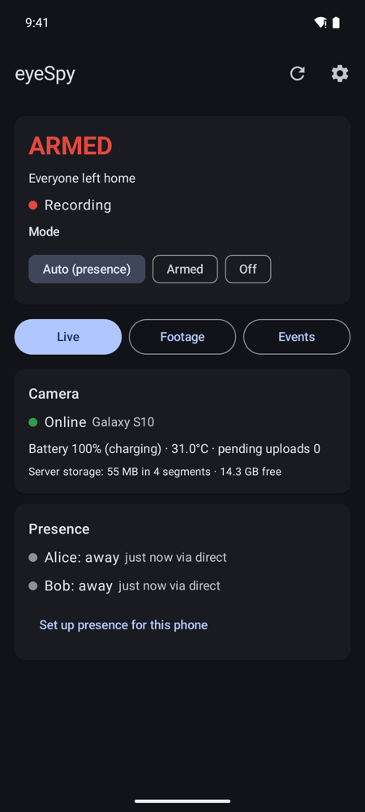
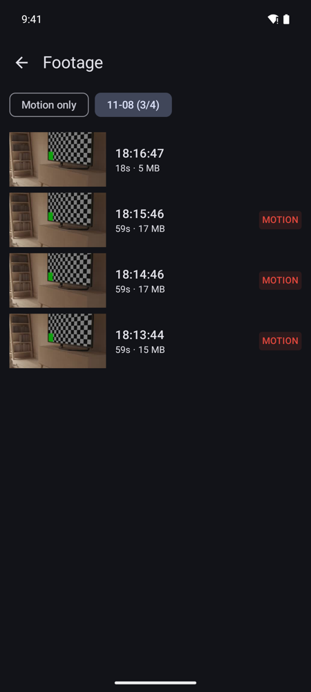
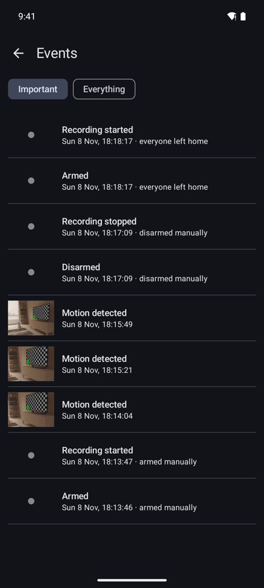
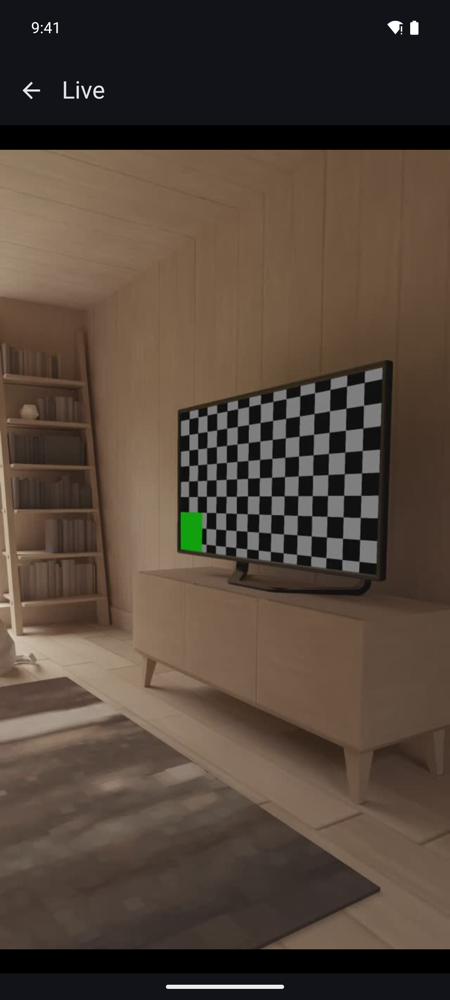
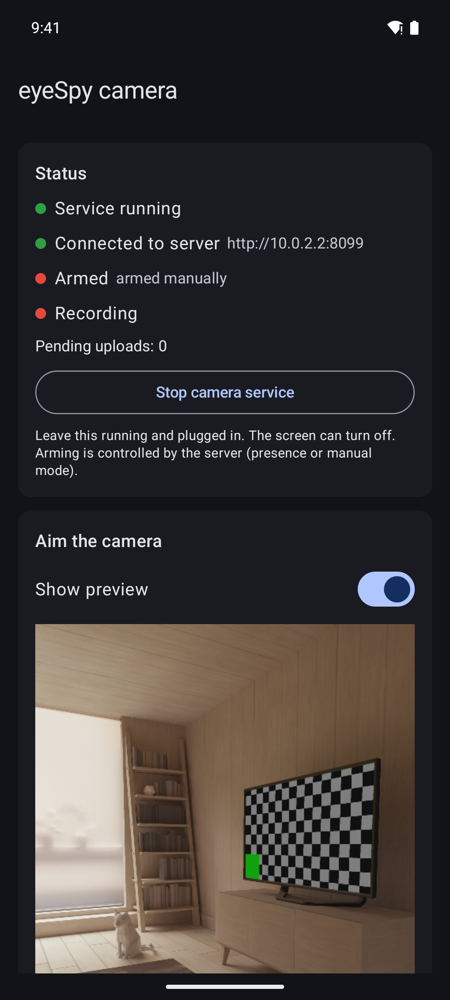

# eyeSpy: free, self-hosted Android security camera

Turn an old Android phone into a **home security camera** with motion detection, live view,
recorded footage and push notifications. It arms itself when everyone has left home and disarms
when someone comes back. Footage stays on your own server: **no cloud, no subscription, no ads,
no account**.

<p>
  
  
  
  
  
</p>

<sub>Screenshots from the Android emulator's virtual room.</sub>

## Features

- **Old phone as a CCTV / IP camera**: records 720p/1080p video in short segments, even with the
  screen off.
- **Motion detection** with lighting-change rejection, snapshots and an adjustable sensitivity.
- **Auto arm / disarm by presence**: a geofence on your phone tells the server when you leave and
  return. Manual *Armed* / *Off* modes too.
- **Push notifications on any network** through [ntfy](https://ntfy.sh): recording started or
  stopped, motion detected, camera offline. Tapping one opens the clip.
- **Viewer app**: status, live view, footage by day, events. There's also a small web dashboard.
- **Retention**: keeps footage without motion for 3 days and footage with motion for 14 days. You
  can also set a disk cap.
- **Private by design**: footage never leaves your network. Presence updates relayed through ntfy
  are end-to-end encrypted, and notification texts are generic.

## How it works

```
 old phone (camera mode) ──Wi-Fi──► home server (Docker) ◄──LAN / VPN── your phone (viewer mode)
                                        │        ▲
                           push via ntfy │        │ presence via ntfy (encrypted)
                                        ▼        │
                                      your phone, anywhere
```

One app, two roles: the **camera** phone stays at home, plugged in. The **viewer** is your own
phone. The **server** is a small FastAPI + ffmpeg + SQLite container on any always-on machine
(Raspberry Pi, NAS, mini PC, home server). It decides when to record and stores the footage.

You need:
- an old Android phone (Android 11+) as the camera
- your own Android phone
- a machine with Docker on your home network
- a VPN to reach home if you want footage and live view while away (WireGuard, Tailscale, …).
  Push notifications work without it.

## Setup with an AI coding agent

Paste this into Claude Code, Codex, Cursor or a similar agent, running on a computer that can
reach your server over SSH and has both phones connected over USB (with USB debugging on):

```text
Set up eyeSpy (https://github.com/Ermag/eyespy), a self-hosted Android security camera, for me.

1. Clone the repo. Ask me for the SSH host of my always-on home server, and the LAN IP of that server.
2. On the server: check Docker and Docker Compose are installed, pick a free port (default 8080),
   copy the repo's server/ folder, docker-compose.yml and .env.example into ~/eyespy, and create
   ~/eyespy/.env from .env.example with:
   - EYESPY_TOKEN = `openssl rand -hex 24`, NTFY_TOPIC = `eyespy-$(openssl rand -hex 12)`
   - EYESPY_PORT, EYESPY_UID/EYESPY_GID = the output of `id -u` / `id -g`, TZ = my timezone
   - MAX_STORAGE_GB / MIN_FREE_GB based on the server's free disk (ask me)
   chmod 600 .env, then `docker compose up -d --build` and confirm GET /healthz returns ok.
   Never print the token or topic in chat; tell me which file holds them.
3. Do not forward the port on the router or expose it through any tunnel or reverse proxy.
   It must stay LAN/VPN-only.
4. Build the app: install JDK 17+ and the Android SDK if missing, then run android/release.sh.
   Tell me to back up android/keystore/ (needed for future updates).
5. Install android/dist/eyespy-release.apk on both phones with `adb -s <serial> install`.
   If the install hangs, `adb push` it to /data/local/tmp and run `pm install` there.
6. Walk me through each phone's setup screen: server URL http://<server-ip>:<port> and the token
   (type it with `adb shell input text` so it never appears in chat).
   Camera phone: role Camera, grant permissions, then the in-app Reliability checklist.
   My phone: role Viewer, install the ntfy app, Settings > Grant location (Allow all the time),
   set home location, turn on "Use this phone", Subscribe in ntfy app, Send test notification.
7. Verify: GET /api/status with the token shows the camera online and my phone's presence.
   Then remind me to turn off USB debugging on both phones.
```

## Manual setup

### 1. Server

```bash
git clone https://github.com/Ermag/eyespy && cd eyespy
cp .env.example .env
```

In `.env`, set:
- `EYESPY_TOKEN`: `openssl rand -hex 24`
- `NTFY_TOPIC`: `echo eyespy-$(openssl rand -hex 12)`. Anyone who knows the topic can read your
  notifications, so keep it random.
- `TZ`, `EYESPY_PORT`, `EYESPY_UID`/`EYESPY_GID` (from `id`), and the retention values.

```bash
chmod 600 .env
docker compose up -d --build
curl http://localhost:8080/healthz
```

Keep the port LAN/VPN-only: don't forward it on your router. Push notifications and presence only
use outbound HTTPS to ntfy.sh, and you can [self-host ntfy](https://docs.ntfy.sh/install/) instead.

### 2. Build the app

You need JDK 17+ and the Android SDK (Android Studio installs both).

```bash
android/release.sh
```

The first run creates your signing key in `android/keystore/`. **Back it up**: updates must be
signed with the same key. Install the APK on both phones:

```bash
adb install -r android/dist/eyespy-release.apk
```

You can also copy the APK to the phone and open it there (allow "install unknown apps").

### 3. Camera phone

1. Open eyeSpy and pick **Camera**. Enter `http://<server-ip>:8080` and the token, then tap
   **Connect**.
2. Grant the camera and notification permissions.
3. Work through the **Reliability checklist** in the app:
   - **Unrestricted battery**. On Samsung, also add eyeSpy under *Never sleeping apps*.
   - **Display over other apps**, so the camera restarts after a reboot.
   - **Battery protection** (charge limit), since the phone is always plugged in.
4. Turn on **Show preview** to aim the camera, then let the screen turn off.

### 4. Your phone (viewer)

1. Install the **ntfy** app ([Play Store](https://play.google.com/store/apps/details?id=io.heckel.ntfy)
   or [F-Droid](https://f-droid.org/packages/io.heckel.ntfy/)).
2. Open eyeSpy and pick **Viewer**. Enter the server URL, the token and your name. Do this on home
   Wi-Fi or VPN.
3. In **Settings**:
   - **Grant location** and choose *Allow all the time*.
   - Set your home location, then turn on **Use this phone**.
   - Tap **Subscribe in ntfy app**, then **Send test notification**.
4. Set the mode to **Auto (presence)**.

Repeat on every household member's phone. The camera arms only when everyone is away.

## Security and privacy

- One API token, sent in an `Authorization` header and never in URLs. The web dashboard uses
  short-lived, read-only media tokens.
- Traffic between the phones and the server is plain HTTP, so keep it on your LAN or VPN.
- What goes through ntfy:
  - generic notification texts ("Motion at 14:42")
  - presence updates, encrypted with AES-256-GCM using a key derived from your token
  - snapshots, only if you set `NTFY_ATTACH_SNAPSHOT=true`
- The container runs as your user, with a read-only filesystem and no Linux capabilities.
- Turn off USB debugging on the phones once they're set up.
- Rotate the token by changing `EYESPY_TOKEN`, running `docker compose up -d`, and re-entering it
  in both apps (Settings › Change role / server).
- Recording audio is off by default. Check your local laws before recording audio or other people.

## Limits

- Geofence transitions take 1–3 minutes. Use **Armed** mode to start recording immediately.
- Each segment boundary has a sub-second gap.
- Motion detection is frame differencing. Pets, curtains and TVs can trigger it, so tune the
  sensitivity.
- Android only. There's no iOS app.

## Similar apps

eyeSpy is a free, open-source alternative to old-phone security camera apps such as **Alfred
Camera**, **AtHome Camera**, **Manything** and **IP Webcam**, without their cloud or subscription.
It's closer to **Haven** (Guardian Project) in spirit. Unlike NVRs such as **Frigate**,
**ZoneMinder**, **Shinobi** or **motionEye**, it needs no IP camera: the phone is the camera.

## License

[MIT](LICENSE)
